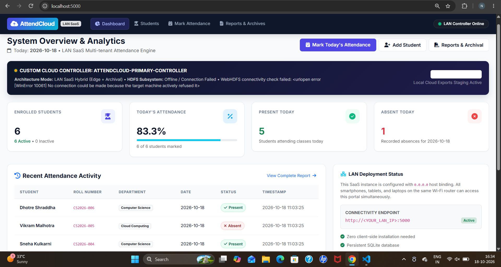
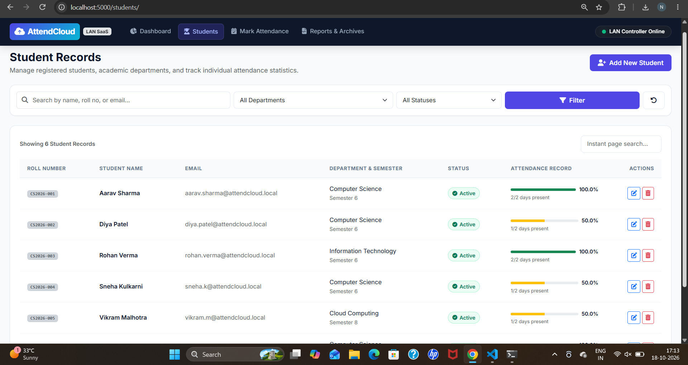
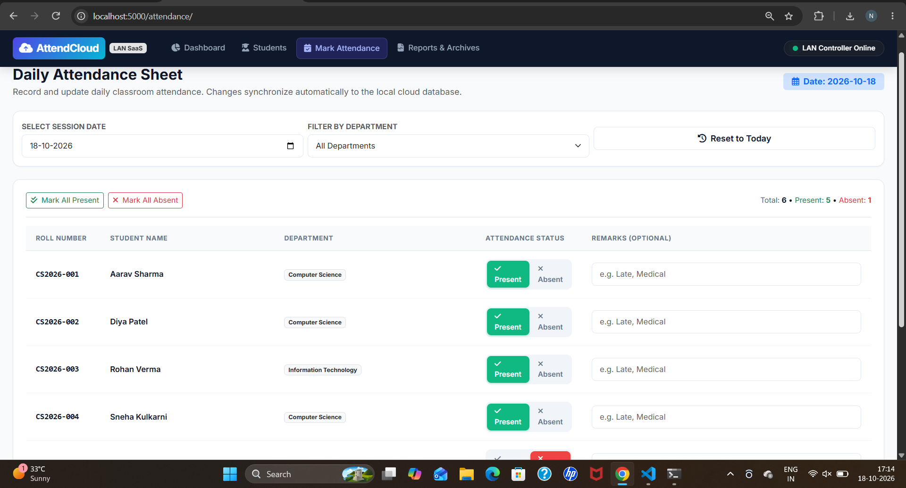
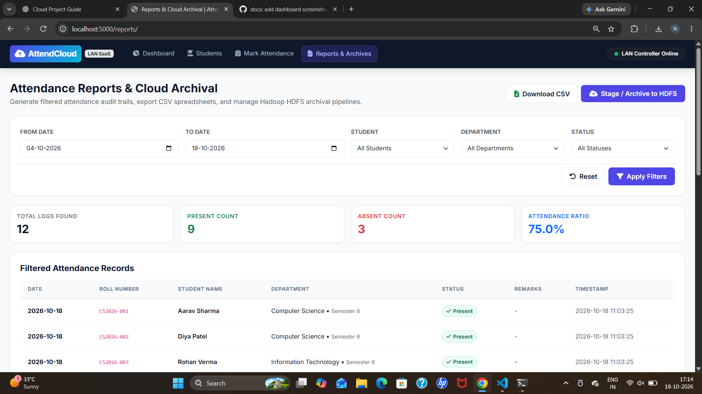
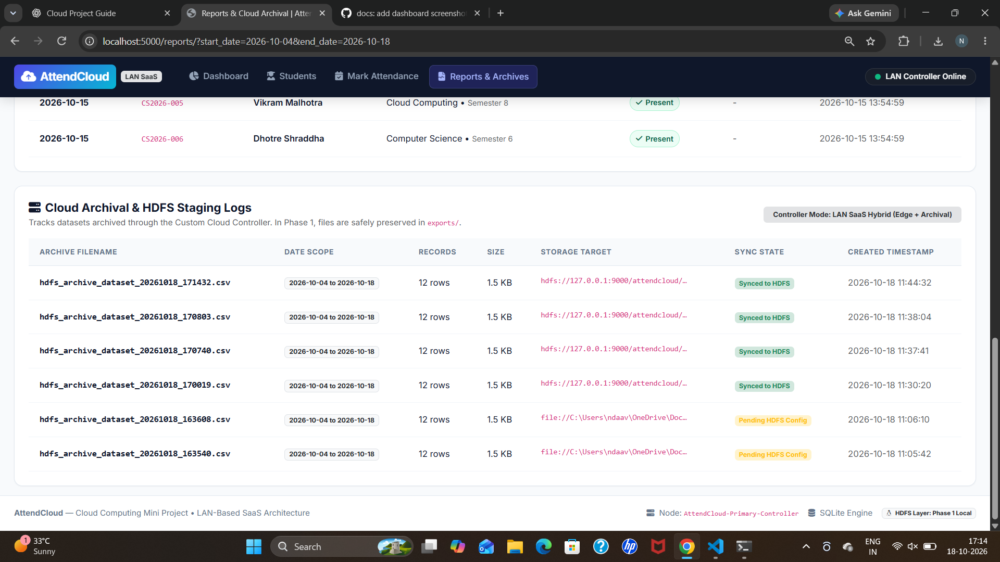

# AttendCloud: A LAN-Based SaaS Attendance Management System

### Using Apache Hadoop HDFS and a Custom Cloud Controller

AttendCloud is a Software-as-a-Service (SaaS) attendance management system designed for a Cloud Computing mini-project. It runs on a local computer and allows authorized users on the same Local Area Network (LAN) to access attendance management features through a web browser.

The application uses Flask for the web interface, SQLite for operational data, and Apache Hadoop HDFS for distributed archival of attendance reports through the WebHDFS REST API.

## 🌟 Key Features

### 1. SaaS Dashboard
- Displays total enrolled students, attendance statistics, present count, and absent count.
- Shows the status of the custom cloud controller.
- Provides a recent attendance overview.

### 2. Student Management
- Register, update, and search student records.
- Search students using details such as roll number, name, and department.
- Track attendance percentages using recorded attendance data.

### 3. Daily Attendance Management
- Mark attendance for individual students.
- Use bulk controls to mark students present or absent.
- Store attendance remarks and notes.
- Use SQLite database operations to maintain attendance records.

### 4. Attendance Analytics and CSV Reporting
- Filter attendance reports using available date, student, department, and status filters.
- Export attendance data as CSV files.
- Open exported reports in spreadsheet applications such as Microsoft Excel.

### 5. Custom Cloud Controller and HDFS Integration
- Stage attendance reports locally in the `exports/` directory.
- Archive attendance reports to Apache Hadoop HDFS using WebHDFS.
- Record archival operations and synchronization status in SQLite audit logs.
- Support local staging when HDFS archival is unavailable.

### 6. LAN Access
- Run the Flask development server on `0.0.0.0:5000`.
- Access the application locally or from compatible devices connected to the same network.
- Display local and LAN access information in the terminal when the application starts.

---

## 🏛️ System Architecture

```text
              LAN Clients (Laptops and Phones)
                          |
                          | HTTP Requests
                          v
              +--------------------------+
              | Flask Application Server|
              |      Port 5000           |
              +------------+-------------+
                           |
                 +---------+----------+
                 |                    |
                 v                    v
        +----------------+   +----------------------+
        | SQLite Database|   | Custom Cloud         |
        | Student Records|   | Controller           |
        | Attendance     |   +----------+-----------+
        | Archive Logs   |              |
        +----------------+         +----+-----+
                                   |          |
                                   v          v
                            +------------+ +----------------+
                            | Local CSV  | | Apache Hadoop |
                            | Staging    | | HDFS Archive  |
                            | exports/   | | WebHDFS       |
                            +------------+ +----------------+
```

### Technology Stack

| Component | Technology |
|---|---|
| Frontend | HTML, CSS, JavaScript |
| Backend | Python, Flask |
| Operational database | SQLite |
| Distributed archival | Apache Hadoop HDFS |
| HDFS communication | WebHDFS REST API |
| Development environment | Windows, VS Code |
| Hadoop environment | Ubuntu on WSL2 |
| Network access | Local Area Network |

---

## 📁 Project Structure

```text
AttendCloud/
├── config.py
├── run.py
├── requirements.txt
├── README.md
├── README_backup.md
├── .gitignore
│
├── app/
│   ├── __init__.py
│   ├── database.py
│   ├── schema.sql
│   │
│   ├── routes/
│   │   ├── __init__.py
│   │   ├── dashboard.py
│   │   ├── students.py
│   │   ├── attendance.py
│   │   └── reports.py
│   │
│   ├── services/
│   │   ├── __init__.py
│   │   ├── export_service.py
│   │   └── hdfs_service.py
│   │
│   ├── static/
│   │   ├── css/
│   │   │   └── style.css
│   │   └── js/
│   │       └── main.js
│   │
│   └── templates/
│       ├── base.html
│       ├── dashboard.html
│       ├── students/
│       │   ├── index.html
│       │   └── form.html
│       ├── attendance/
│       │   └── mark.html
│       └── reports/
│           └── index.html
│
├── data/
│   └── .gitkeep
│
└── exports/
    └── .gitkeep
```

**Note:** The SQLite database and generated CSV files are created locally at runtime and are excluded from Git using `.gitignore`.

---

## 🚀 Setup and Execution Guide

### Prerequisites

Install or configure the following:

- Python 3
- Git
- Visual Studio Code or another code editor
- Apache Hadoop 3.5.0 and Java 17 if you want to use the HDFS archival feature
- Ubuntu on WSL2 for the local Hadoop environment

### Step 1: Open the project directory

Open PowerShell and run:

```powershell
cd "$env:USERPROFILE\OneDrive\Documents\AttendCloud"
```

### Step 2: Create and activate a virtual environment

If you do not already have a virtual environment, run:

```powershell
py -m venv .venv
```

Activate it:

```powershell
.\.venv\Scripts\Activate.ps1
```

If PowerShell blocks activation, use the Python executable directly or configure the execution policy appropriately for your environment.

### Step 3: Install dependencies

```powershell
py -m pip install -r requirements.txt
```

### Step 4: Start AttendCloud

```powershell
py run.py
```

Keep the terminal open while using the application.

### Step 5: Open the application

On the computer running the Flask server, open:

```text
http://localhost:5000
```

The application should be running before you access this URL.

---

## 🌐 Accessing AttendCloud over a LAN

To access the application from another device:

1. Connect the computer and the other device to the same Wi-Fi network.
2. Start AttendCloud on the host computer.
3. Find the LAN IP address displayed by the application or check the host computer's network configuration.
4. Open a browser on the other device and visit:

```text
http://<HOST_LAN_IP>:5000
```

Replace `<HOST_LAN_IP>` with the actual LAN IP address of the host computer.

For example, if the host IP is `192.168.1.15`, use:

```text
http://192.168.1.15:5000
```

If the page cannot be opened, check the Windows Firewall rules and ensure that the host and client devices are on the same reachable network.

**Security note:** The Flask development server is intended for local development and demonstration. Do not expose it directly to the public internet.

---

## 🐘 Apache Hadoop HDFS Integration

AttendCloud includes a WebHDFS archival service in `app/services/hdfs_service.py`. The application's archival workflow has been tested with the local Hadoop HDFS environment, including successful report archival and verification of archived files in HDFS.

### 1. Archival Workflow

The archival process consists of these stages:

1. Generate an attendance report in CSV format.
2. Stage the report locally in the `exports/` directory.
3. Use the custom cloud controller to request archival through WebHDFS.
4. Transfer the report to the configured HDFS archive directory.
5. Record the archival result in the SQLite `archive_logs` table.

The application can retain locally staged reports when HDFS archival is unavailable, depending on the configured archival behavior.

### 2. HDFS Configuration

The following environment variables are examples for the local Windows-to-WSL Hadoop setup. Use the values supported by your current `config.py` and environment.

```powershell
$env:HDFS_ENABLED="True"
$env:HDFS_NAMENODE_HOST="127.0.0.1"
$env:HDFS_NAMENODE_PORT="9870"
$env:HDFS_USER="ndaav"
$env:HDFS_ARCHIVE_DIR="/attendcloud/archive"
```

These variables apply to the current PowerShell session. Set them before starting the application if your configuration relies on environment variables.

### 3. Start the Hadoop Cluster

In the Ubuntu/WSL terminal, start Hadoop's HDFS services:

```bash
start-dfs.sh
```

Check the Java processes:

```bash
jps
```

The running Hadoop services should include the relevant NameNode and DataNode processes.

### 4. Verify the HDFS Archive

List the archived reports:

```bash
hdfs dfs -ls /attendcloud/archive
```

To inspect a specific archived CSV file:

```bash
hdfs dfs -cat /attendcloud/archive/<filename>.csv
```

Replace `<filename>.csv` with an actual filename returned by the listing command.

### 5. Troubleshooting

**HDFS is unavailable**

- Verify that the NameNode and DataNode are running.
- Confirm the WebHDFS endpoint and port.
- Check the HDFS archive directory and configuration.

**HTTP 403 Forbidden**

- Check the HDFS username and directory permissions.
- Confirm that the configured user has the necessary write permissions.
- Review the application logs and HDFS error message before changing permissions.

**DataNode redirection issues**

- In WSL or virtualized environments, the NameNode may redirect upload requests to a hostname that Windows cannot resolve.
- Verify that the DataNode endpoint is reachable from the Windows host.
- Check the hostname-resolution logic in `hdfs_service.py` if uploads fail.

---

## 🗄️ Database and Data Management

AttendCloud uses SQLite for student records, attendance entries, and archival audit logs.

The database is stored locally in:

```text
data/attendcloud.db
```

The application initializes its database according to its database setup logic. Generated report files are stored in the local `exports/` directory.

The `.gitignore` file excludes the local database files, generated CSV exports, Python virtual environment, and cache files from being added as new Git-tracked files.

Do not commit actual student records, private data, credentials, or other sensitive information to a public repository.

---

## 🔒 Security and Limitations

- Use sample or anonymized student data in public demonstrations.
- Do not publish passwords, API credentials, or private configuration.
- Restrict access to the application to trusted devices on the LAN.
- The project uses SQLite for its operational database; HDFS is used for report archival rather than as a replacement for SQLite.
- The Flask development server is suitable for development and academic demonstration, not production deployment without additional security and deployment configuration.

---

## 🎯 Future Scope

Potential future improvements include:

- Role-based authentication and authorization.
- Secure deployment using a production-ready WSGI server and HTTPS.
- Automated scheduled archival and retention policies.
- Enhanced dashboards and attendance trend visualizations.
- Integration with institutional identity systems.
- More detailed monitoring and audit reporting.

These are potential extensions and should not be interpreted as features already implemented.

---
## Screenshots

### 1. Dashboard
The dashboard provides an overview of attendance activity and quick access to the main modules.



### 2. Student Management
This section displays student records and their academic details.



### 3. Mark Attendance
This module allows attendance to be recorded for enrolled students.



### 4. Reports & Cloud Archival
The reports section provides attendance records, date-based filtering, and cloud archival logs.



### 5. HDFS Archive Verification
This screenshot demonstrates the archived files stored in the HDFS archive directory.


## 📚 References

1. [Flask Documentation](https://flask.palletsprojects.com/)
2. [Apache Hadoop Documentation](https://hadoop.apache.org/docs/)
3. [Apache Hadoop HDFS Architecture](https://hadoop.apache.org/docs/stable/hadoop-project-dist/hadoop-hdfs/HdfsDesign.html)
4. [Python Documentation](https://docs.python.org/3/)
5. [Git Documentation](https://git-scm.com/doc)

---

**Project:** AttendCloud — A LAN-Based SaaS Attendance Management System

**Focus:** Cloud Computing, SaaS, LAN-based web applications, SQLite, and Apache Hadoop HDFS archival.
